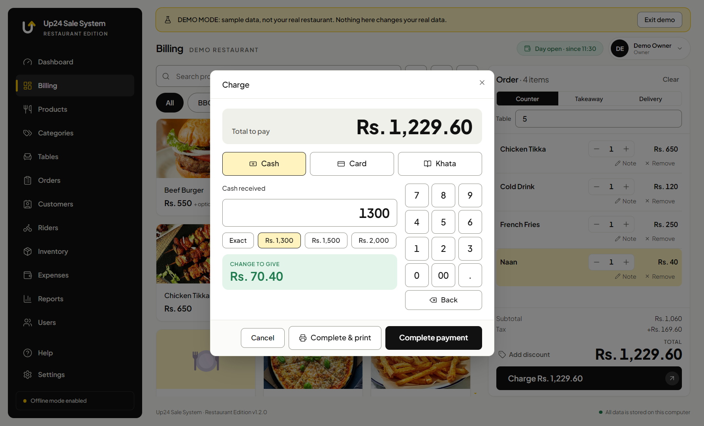
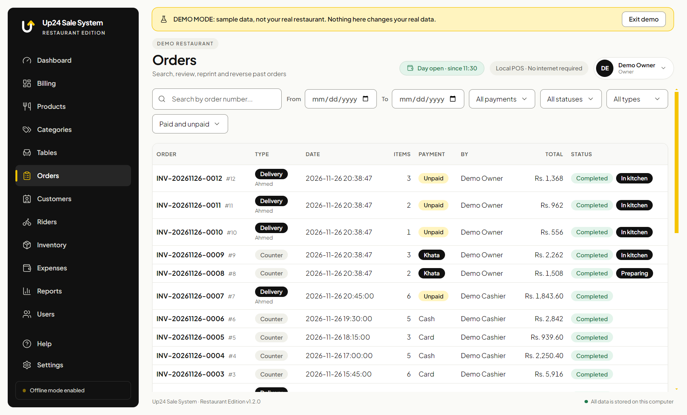
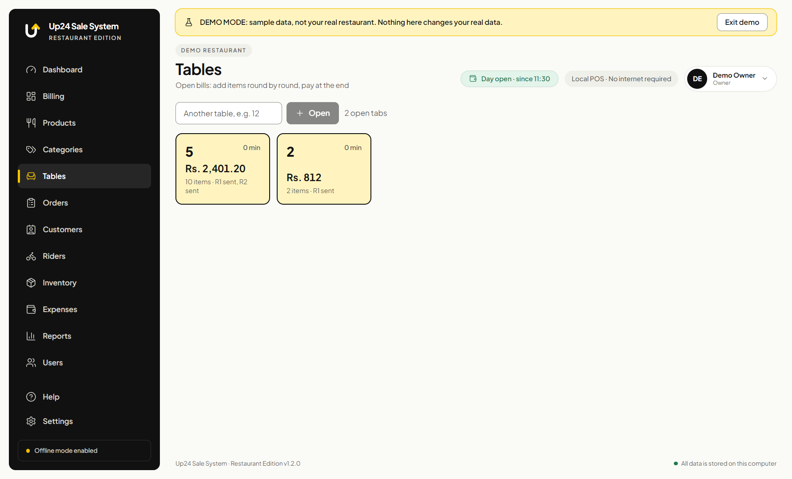
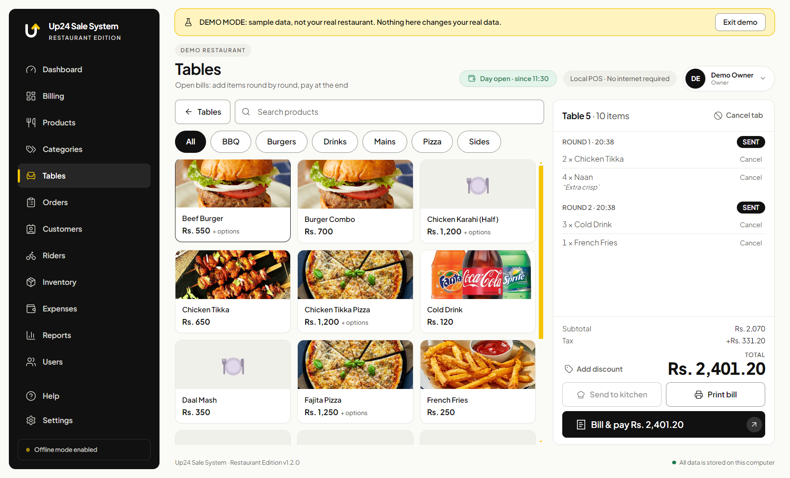
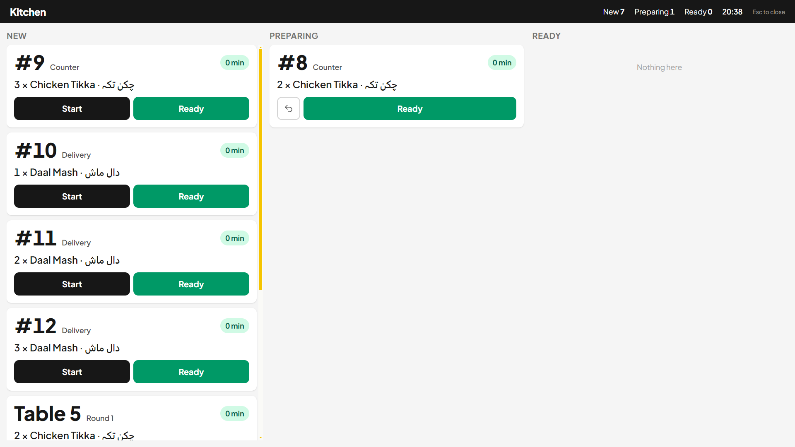
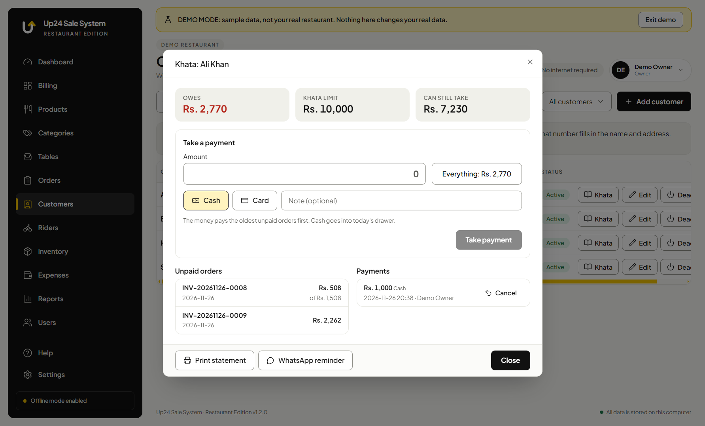
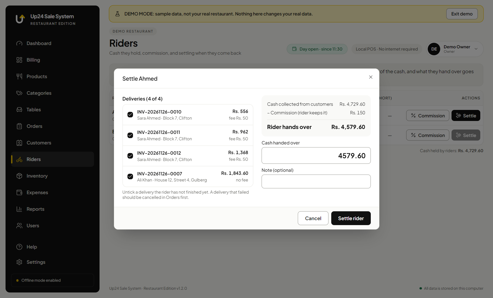
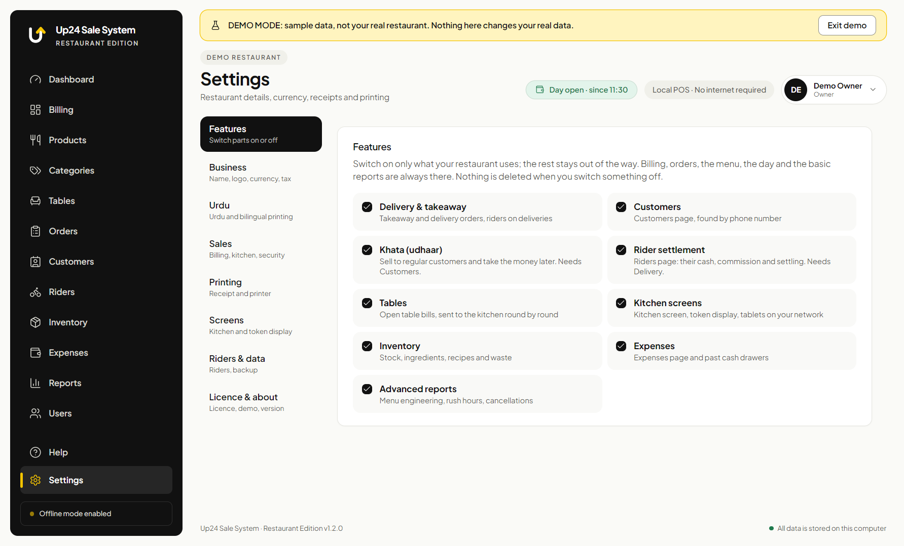
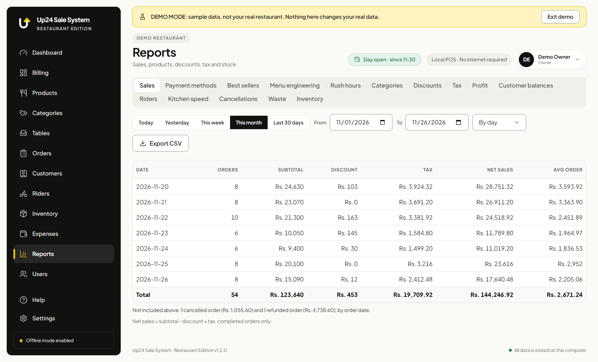

# Up24 Sale System · Restaurant Edition

A fast, offline-first point-of-sale for restaurants on Windows. Take orders at the counter or table by table, send them to the kitchen, run khata and riders, track stock and ingredients, and see what you really earn. Everything stays on your own computer and works without internet. Switch on only the features your restaurant needs.

**By Up24 Solutions**

[**Download the latest installer →**](../../releases/latest)

> This repository only hosts the installer and its documentation. The source code is private.

---

## Screenshots

All screenshots use the built-in **demo data** (a made-up "Demo Restaurant"), not a real business.

### Billing: your own food photos, a clean order panel, one big Charge button

### Charge screen: cash, card or khata, quick amounts, keypad and change

### Receipts in English, Urdu or both (58 mm and 80 mm), with a preview before printing

### Orders: search, reprint, cancel and refund

### Tables: open bills, added round by round, paid at the end

### A table's bill: send each round to the kitchen, print the bill, take payment

### Kitchen screen: New, Preparing and Ready, with Urdu dish names

### Khata: what each customer owes, payments, statement and WhatsApp reminder

### Riders: the cash they hold, their commission, and settling up

### Features: switch on only what you use

### Add all your food photos in one go: pick a folder, the app matches the files to your products by name

### Products with their photos

### Dashboard: today's sales at a glance

### Ingredients: know what you cook with, and when it runs low

### Recipes: the real cost and profit of every dish

### Reports: sales, payment methods, best sellers, tax, profit and stock (export to CSV)

---

## What you get

**Selling**
- Counter, takeaway and delivery orders, with an optional table number on counter orders
- Charge screen with cash, card, khata or pay-on-delivery, quick amounts and change
- **Table bills:** keep a table's bill open, add items round by round and take payment at the end
- **Customers and khata (udhaar):** find a customer by phone number, set a khata limit, take part payments, print a statement or send a WhatsApp reminder
- **Rider settlement:** the cash each rider holds, commission (fixed or percentage) and a settlement slip
- Discounts by amount or percentage, with a manager's approval above the cashier limit
- Keyboard shortcuts for a fast till, a full-screen Billing mode and an on-screen touch keyboard for the search box
- Per-item notes, size and extras options, and deals / combos
- Food photos on every product: pick a folder and the app matches the pictures to your products by name

**Kitchen and printing**
- Kitchen tickets that go to the right printer for each category
- Receipts in English, Urdu or both, for 58 mm and 80 mm paper
- A preview before receipts, table bills, khata statements, day reports and rider slips are printed
- **Kitchen screen and token display:** on a second monitor, or on a tablet or phone on the same Wi-Fi
- Works with ordinary Windows printers or direct ESC/POS thermal printers

**Stock and profit**
- Stock levels for ready items (drinks, bread) and **ingredients with recipes** for cooked dishes
- Real food cost and profit per dish, with low-stock alerts
- **Menu engineering:** every dish is rated Star, Plowhorse, Puzzle or Dog, so you know what to keep, promote or rework
- **Rush hours:** a colour grid of your busiest hours and days, and a dashboard alert when an ingredient price rise cuts a dish's margin
- Cash drawer: open and close the day, count the cash, see any difference
- **Waste and cancellations:** food made and then cancelled is counted as waste, with reports showing what was cancelled, by whom and why
- Expenses and profit reports, exported to CSV

**Running the business**
- **Features on or off** in Settings, so staff only see what your restaurant uses
- Staff accounts with PINs for owner, manager and cashier
- Import your menu from Excel or CSV, and a setup wizard for the first start
- Automatic backups, plus a safety copy of your data before any database upgrade
- A demo mode to practise with fake data
- 100% offline: your data never leaves your computer

---

## Install

**Requirements:** Windows 10 or 11 (64-bit). No internet needed.

1. Download the **Setup .exe** (for example `Up24-Sale-System-Restaurant-Edition-Setup-1.2.0.exe`) from the [latest release](../../releases/latest).
2. Run it and follow the steps (you can choose the install folder).
3. Open **Up24 Sale System Restaurant Edition** from the desktop or Start menu.
4. The first start asks you to create the owner account and walks you through the basic settings.

> **Windows may show "Windows protected your PC".** This installer is not yet signed with a paid code-signing certificate, so Windows says the publisher is unknown. Click **More info → Run anyway**.

## Free trial and licence

- Every installation includes a **10-day free trial** with every feature available.
- After the trial the app becomes **read-only**: you can still look at orders and reports and make backups, but you cannot sell until a licence key is entered.
- To buy a licence open **Settings → Licence & about** and press **Send on WhatsApp**. It opens a message with your computer's machine code ready to send. You receive a licence key that works on that computer only. Paste it into the same screen.

## Your data and updates

- Your data lives on your computer in `%APPDATA%\restaurant-pos`. It is **not** deleted when you update or uninstall.
- To update, open **Settings → Licence & about** and press **Check for updates**, then **Download and install**: the app downloads the new version, checks that it is genuine, makes a backup of your data, then closes and opens the installer. (Version 1.1.1 and newer.)
- On an older version, download the newer installer from the [Releases](../../releases) page once and run it over the old one.
- Either way your menu, orders and settings stay, and the app makes a safety copy of your database before it upgrades it.
- Good habit: before updating, take a manual backup to a USB drive (**Settings → Backup**).

## Support

Questions, a licence key, or something not working? Contact **Up24 Solutions**.

---

© Up24 Solutions. All rights reserved.
