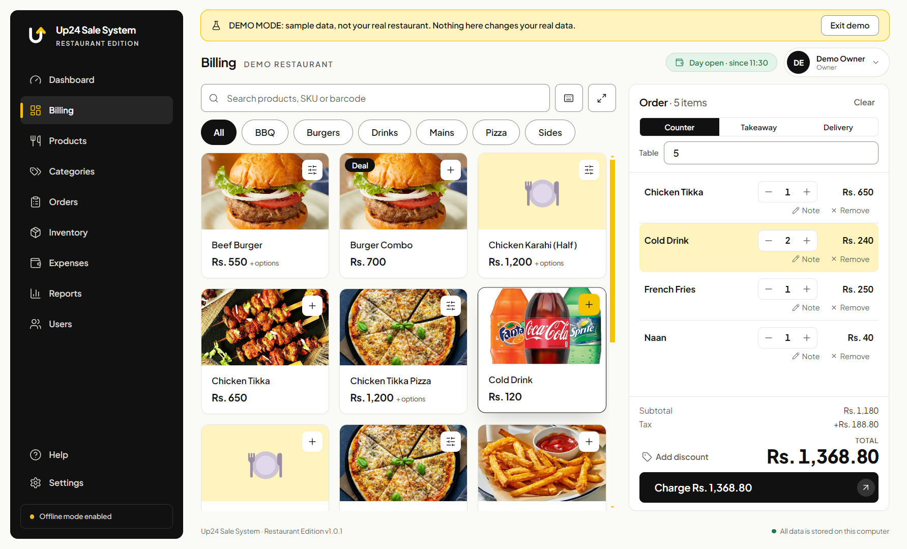
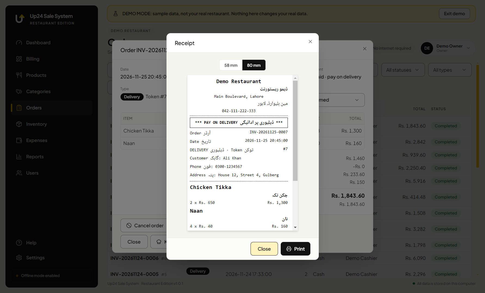
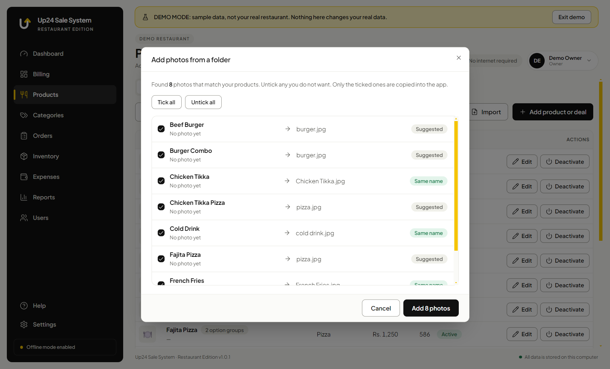
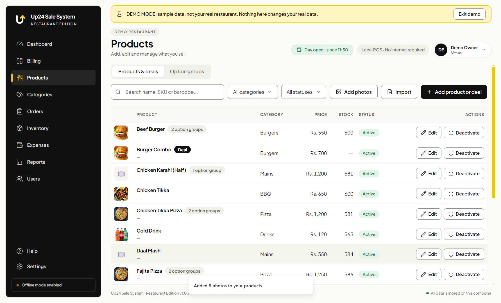
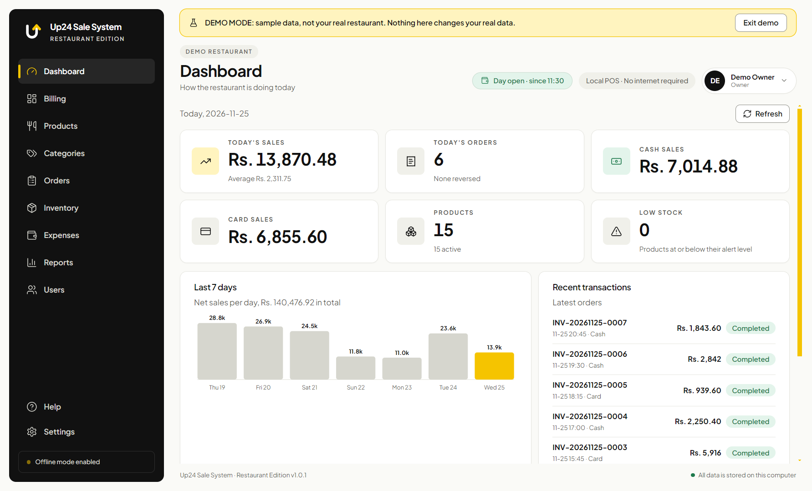
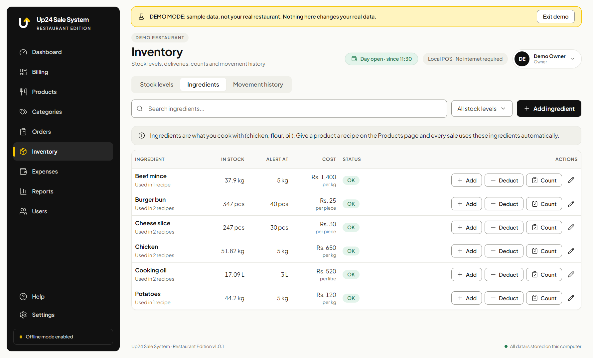
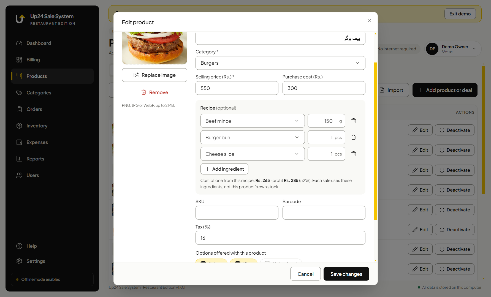

# Up24 Sale System · Restaurant Edition

A fast, offline-first point-of-sale for restaurants on Windows. Take orders at the counter, print receipts and kitchen tickets, track stock and ingredients, and see what you really earn. Everything stays on your own computer and works without internet.

**By Up24 Solutions**

[**Download the latest installer →**](../../releases/latest)

> This repository only hosts the installer and its documentation. The source code is private.

---

## Screenshots

All screenshots use the built-in **demo data** (a made-up "Demo Restaurant"), not a real business.

### Billing: your own food photos, a clean order panel, one big Charge button

### Charge screen: cash, card or pay later, quick amounts, keypad and change

### Receipts in English, Urdu or both (58 mm and 80 mm)

### Orders: search, reprint, cancel and refund

### Add all your food photos in one go: pick a folder, the app matches the files to your products by name

### Products with their photos

### Dashboard: today's sales at a glance

### Ingredients: know what you cook with, and when it runs low

### Recipes: the real cost and profit of every dish

### Reports: sales, payment methods, best sellers, tax, profit and stock (export to CSV)

---

## What you get

**Selling**
- Counter, takeaway and delivery orders, with an optional table number on counter orders
- Charge screen with cash, card or pay-on-delivery, quick amounts and change
- Discounts by amount or percentage, with a manager's approval above the cashier limit
- Keyboard shortcuts for a fast till, a full-screen Billing mode and an on-screen touch keyboard for the search box
- Per-item notes, size and extras options, and deals / combos
- Food photos on every product: pick a folder and the app matches the pictures to your products by name

**Kitchen and printing**
- Kitchen tickets that go to the right printer for each category
- Receipts in English, Urdu or both, for 58 mm and 80 mm paper
- Works with ordinary Windows printers or direct ESC/POS thermal printers

**Stock and profit**
- Stock levels for ready items (drinks, bread) and **ingredients with recipes** for cooked dishes
- Real food cost and profit per dish, with low-stock alerts
- Cash drawer: open and close the day, count the cash, see any difference
- Expenses and profit reports, exported to CSV

**Running the business**
- Staff accounts with PINs for owner, manager and cashier
- Import your menu from Excel or CSV, and a setup wizard for the first start
- Automatic backups, plus a safety copy of your data before any database upgrade
- A demo mode to practise with fake data
- 100% offline: your data never leaves your computer

---

## Install

**Requirements:** Windows 10 or 11 (64-bit). No internet needed.

1. Download the **Setup .exe** (for example `Up24-Sale-System-Restaurant-Edition-Setup-1.0.1.exe`) from the [latest release](../../releases/latest).
2. Run it and follow the steps (you can choose the install folder).
3. Open **Up24 Sale System Restaurant Edition** from the desktop or Start menu.
4. The first start asks you to create the owner account and walks you through the basic settings.

> **Windows may show "Windows protected your PC".** This installer is not yet signed with a paid code-signing certificate, so Windows says the publisher is unknown. Click **More info → Run anyway**.

## Free trial and licence

- Every installation includes a **10-day free trial** with all features.
- After the trial the app becomes **read-only**: you can still look at orders and reports and make backups, but you cannot sell until a licence key is entered.
- To buy a licence open **Settings → Licence & about** and press **Send on WhatsApp**. It opens a message with your computer's machine code ready to send. You receive a licence key that works on that computer only. Paste it into the same screen.

## Your data and updates

- Your data lives on your computer in `%APPDATA%\restaurant-pos`. It is **not** deleted when you update or uninstall.
- To update, download the newer installer from the [Releases](../../releases) page and run it over the old one. Your menu, orders and settings stay. The app also makes a safety copy of your database before it upgrades it.
- Good habit: before updating, take a manual backup to a USB drive (**Settings → Backup**).

## Support

Questions, a licence key, or something not working? Contact **Up24 Solutions**.

---

© Up24 Solutions. All rights reserved.
